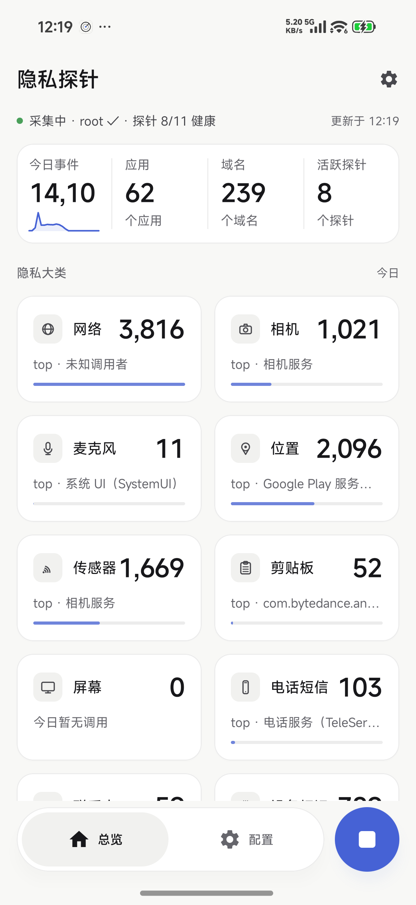
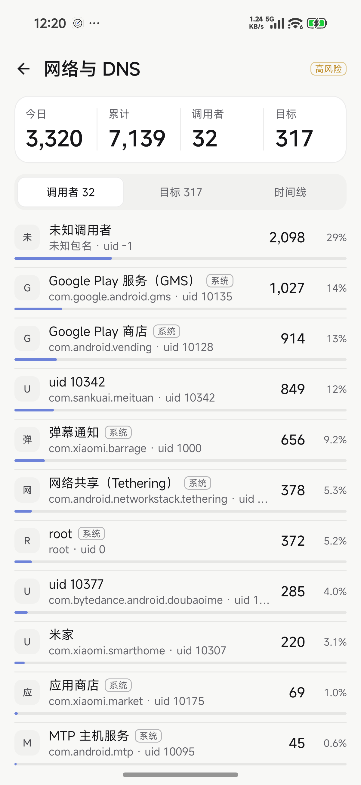
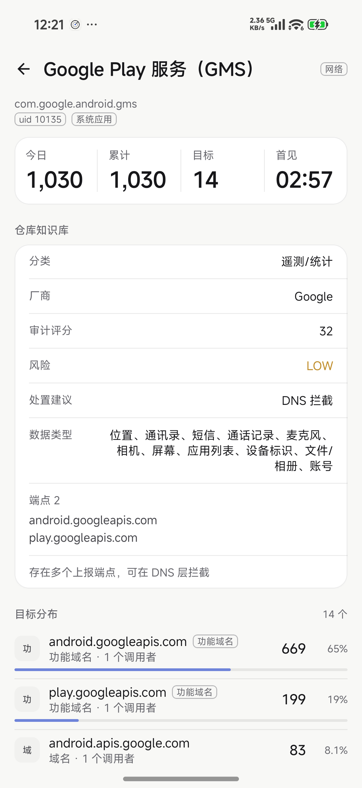
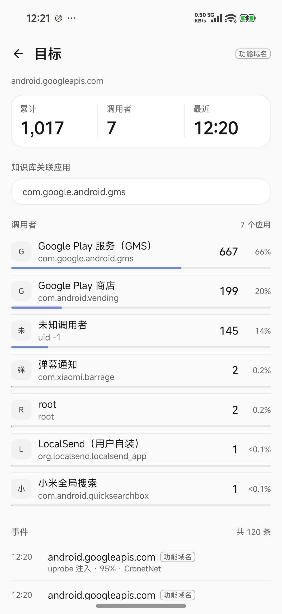
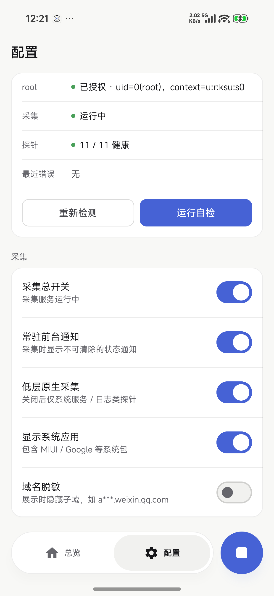
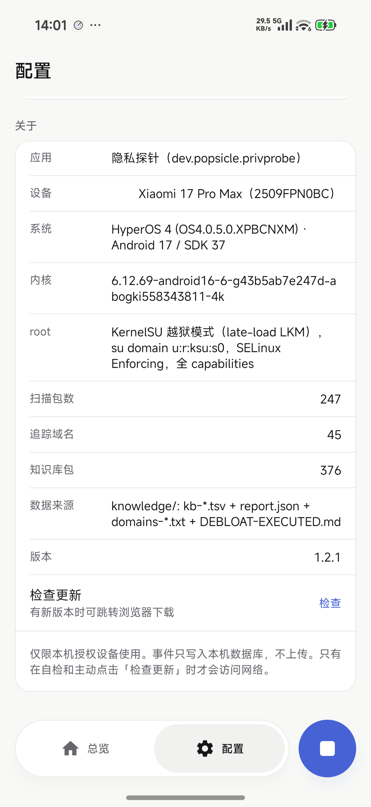
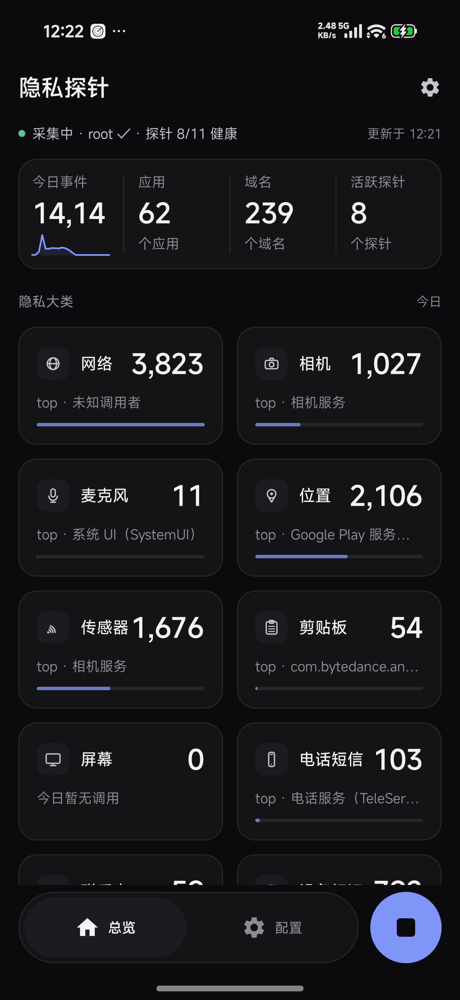
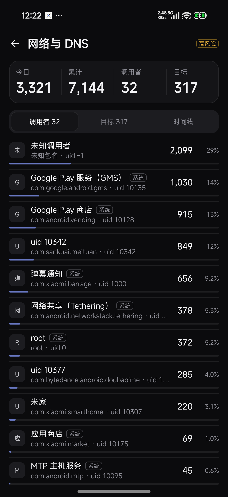
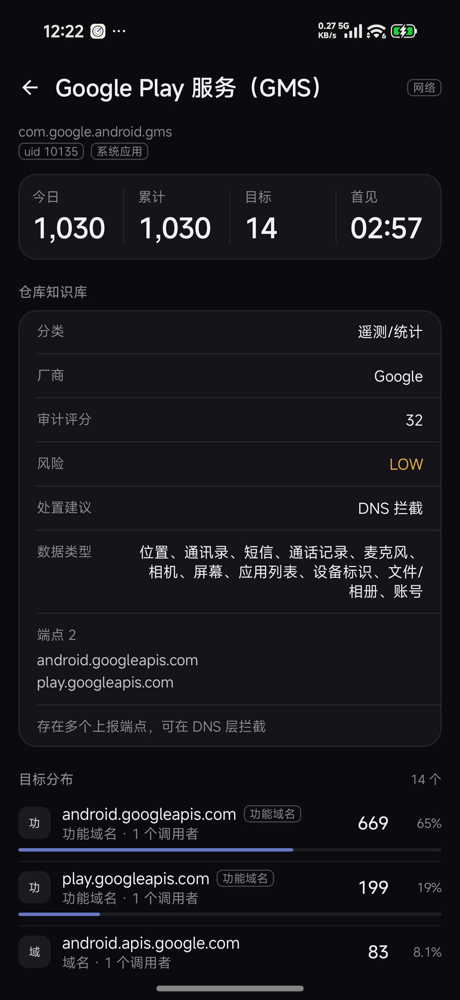

# 隐私探针 PrivacyProbe

<p align="center">
  
</p>

隐私探针是一个跑在自己手机上的隐私审计工具。它借助 root 读取 Android 系统自己记录的行为数据
（dumpsys、logcat、/proc 和内核抓包），把「哪个应用在什么时候打开了摄像头、麦克风、定位、
传感器、剪贴板，访问了哪些域名」整理成可以翻阅的界面。

数据只保存在手机里，不会上传，也不会分享给第三方。

> 需要 KernelSU / Magisk 等 root 环境，请只在你自己持有并授权的设备上使用。
> 目前以 Xiaomi 17 Pro Max（HyperOS 4 / Android 17）为基准适配；Android 12 及以上、
> arm64 设备可以安装，其它机型可能需要重新调校。

<table align="center">
  <tr>
    <td align="center"><a href="docs/screenshots/ui-dashboard-light.png"></a><br><sub>总览 Dashboard</sub></td>
    <td align="center"><a href="docs/screenshots/ui-category-network-light.png"></a><br><sub>大类详情</sub></td>
    <td align="center"><a href="docs/screenshots/ui-caller-light.png"></a><br><sub>调用者详情</sub></td>
  </tr>
  <tr>
    <td align="center"><a href="docs/screenshots/ui-target-light.png"></a><br><sub>目标详情</sub></td>
    <td align="center"><a href="docs/screenshots/ui-settings-light.png"></a><br><sub>配置</sub></td>
    <td align="center"><a href="docs/screenshots/ui-settings-about-light.png"></a><br><sub>关于 / 设备事实</sub></td>
  </tr>
  <tr>
    <td align="center"><a href="docs/screenshots/ui-dashboard-dark.png"></a><br><sub>总览（深色）</sub></td>
    <td align="center"><a href="docs/screenshots/ui-category-network-dark.png"></a><br><sub>大类（深色）</sub></td>
    <td align="center"><a href="docs/screenshots/ui-caller-dark.png"></a><br><sub>调用者（深色）</sub></td>
  </tr>
</table>

<p align="center"><sub>真机截图 · Xiaomi 17 Pro Max / HyperOS 4 / Android 17 · 浅色与深色跟随系统；点击图片查看原图</sub></p>

## 功能

- 总览：今天的敏感行为总数、涉及的应用和域名，以及 11 个大类的次数与主要调用者。
  11 个大类分别是网络与 DNS、相机、麦克风、定位、传感器、剪贴板、屏幕采集、电话与短信、
  通讯录与日历、设备标识、前台应用；底部悬浮的 dock 可以直接开始或停止采集。
- 详情页：可以按调用者看（哪个应用、调用多少次、什么时候），也可以按目标看
  （哪个域名、传感器或摄像头，被哪些应用访问），每个方向都有完整时间线。
- 应用知识：内置常见应用的分类、厂商、审计评分、风险、处置建议和已知上报端点；
  追踪器域名会单独标出来，避免把正常功能域名当成跟踪。
- 导出：支持 CSV 和 JSONL，导出时自己选择保存位置。
- 自检：可以主动触发相机、麦克风、定位等行为，确认「采集到入库」这条链路是否正常。
- 检查更新：在配置页手动查询 GitHub 上的最新版本，有新版本时可以直接跳转浏览器下载；
  只有点击时才会联网。
- 采集默认关闭，由你决定什么时候开始。

## 安装

需要 Android 12 及以上、arm64 设备，并且有 KernelSU 或 Magisk root。

1. 在 [Releases](https://github.com/starriv/privacy-probe/releases/latest) 下载最新的
   `privacy-probe-<版本>.apk`。
2. 允许安装未知来源应用后安装。
3. 打开 App，按提示允许 root。如果系统询问「是否允许获取已安装的应用信息」，选择「始终允许」，
   这项权限只用来把行为对应到具体应用。随后在「配置」页打开采集开关。
4. 在配置页点「自检」，按提示授予相机、麦克风、定位权限，确认探针健康度为 11/11。

HyperOS 可能会拒绝普通的 `adb install`，可以用 root 安装：

```sh
adb push privacy-probe-<版本>.apk /data/local/tmp/privprobe.apk
adb shell "su -c 'pm install -r /data/local/tmp/privprobe.apk'"
adb shell am start -n dev.popsicle.privprobe/.MainActivity
```

升级直接覆盖安装即可，卸载会清空手机里的本地数据。下载页同时提供 `SHA256SUMS.txt`，
可以用来校验安装包。

## 实现原理

Android 把不少系统状态暴露在 `dumpsys` 和 `logcat` 里，网络流量和内核函数调用则要看更底层的接口。
隐私探针通过 root shell 读取这些信息：`dumpsys` 类探针定时读取系统服务状态并计算增量，
`logcat` 探针解析系统日志，随 App 附带的原生程序 `privd` 用 AF_PACKET 抓 DNS / TLS SNI / HTTP Host，
用 tracefs 的 uprobe 和 kprobe 记录 `getaddrinfo`、设备打开等事件。

原始事件拿到之后还要归因：`/proc/net` 的端口映射、`/proc/<pid>/status`、包管理器与系统包列表
可以把 pid / uid 对应到应用；DNS 查询则通过 uprobe 或「应答 IP 与随后的连接」来推断调用者。
事件按天写入本地 SQLite，界面查询的是预聚合表，所以数据量变大时也不会卡。

| 类型 | 数据来源 |
|---|---|
| 网络与 DNS | AF_PACKET 抓包；uprobe `getaddrinfo`；`/proc/net` 端口映射 |
| 相机、麦克风、屏幕采集 | `dumpsys` 里系统服务的活跃客户端与会话 |
| 定位、传感器 | `dumpsys location` / `sensorservice` 的监听器与事件 |
| 剪贴板、敏感权限 | logcat 日志 + `dumpsys appops` 增量 |
| 前台应用、进程 | logcat `ActivityTaskManager`、内核进程 exec 事件 |
| 底层设备打开 | kprobe `v4l2_open` / `snd_pcm_open` |

采集过程只读：不 hook 应用、不注入代码、不修改系统设置。数据存放在 App 私有目录，
默认保留 7 天，可以手动清空，每批写入后检查 30 万行 / 150 MiB 有效数据容量；读事务占用的 WAL 可能暂时超出文件预算。应用没有统计 SDK 和上传接口，
`INTERNET` 权限只用于自检时的一次 DNS 解析，以及你主动点击「检查更新」时访问 GitHub。

## 已知限制

1. App 的 DNS 请求大多由 netd（uid 1052）发出，抓包只能看到域名和 uid；具体是哪个应用发起的，
   需要靠 `getaddrinfo` uprobe 或「DNS 应答 IP → 随后的连接」来推断，界面会标出置信度。
2. 只能看到 TLS SNI，看不到 DoH / DoT 的内层域名；QUIC（HTTP/3）目前也没有解析。
3. 相机、麦克风的底层打开者可能是 cameraserver 或 audioserver，最终调用者依赖系统服务接口归因。
4. AppOps 的全量 dump 有 2 MB 左右，所以单独低频轮询，实时性由其它探针补充。
5. KernelSU 和 Magisk 的 SELinux 策略不同，root 环境可能导致部分探针降级，配置页可以看到健康度。
6. `privd` 目前只提供 arm64-v8a；其它架构上网络和内核类探针不可用，系统服务类探针仍然工作。
7. 仓库以 Xiaomi 17 Pro Max 的内核和系统接口为基准，换机型时 uprobe 偏移或 dumpsys 字段可能需要重新适配。

## 许可

本项目原创代码和文档使用 [MIT](LICENSE) 许可，仅限在你自己持有并授权的设备上使用。

界面设计参考了 [dashboard-design skill](https://github.com/abdiraimov-otabek/dashboard-design-skill)
（MIT，Otabek Abdiraimov），本地副本与 LICENSE 在 [`docs/design-reference/`](docs/design-reference/)。
KernelSU、Android 系统组件和第三方知识数据版权归各自所有者。
